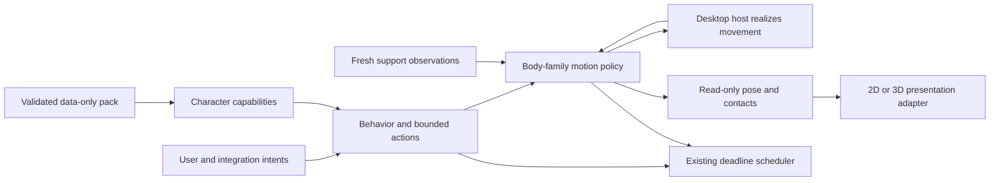

# Better Pets catalogue architecture

Implementation update, 16 October 2026: the user's chosen pixel-rendered 3D
direction supersedes the original 2D-first delivery recommendation below.
Marmalade now proves the live spatial quadruped. Thirteen further biped/quadruped
base pets are implemented; Pebblekin, Margin, Lantern Snail and Velvet have
working experimental motion-family code outside the resident. Signature actions
and prototype promotion remain staged. See the
[current delivery record](../../results/2026-10-16-catalogue-base-implementation.md).

Original design status: proposed architecture, 16 October 2026. The following
sections record the initial capability gaps and recommendations before those
implementation stages, rather than the current completed-feature inventory.

## Intent and decisions

The user requested architecture for all 18 concepts in the [expansion catalogue](../../../reports/Better%20Pets%20expansion%20catalogue.md), plus progress toward quadruped implementation. The purpose is to attract people not served by Mallow, Bramble and Corvid through different forms, materials, personalities and activity levels. Audience appeal remains a hypothesis to test.

This design keeps the existing C++17 resident, Qt Quick presentation, Qt-free character core, data-only packs and single application timer. These choices follow the current project direction. My proposed delivery choices are layered 2D reference packs first, Marmalade as the reference quadruped, a conservative four-beat walk, and a separate subsequent spatial adapter. These are recommendations, not preferences the user has already confirmed.

Success means each proposed pet has an explicit anatomy, representation and action path; the first four-legged pet uses shared motion rather than decorative extra legs; existing pets retain their behavior; and a settled/suppressed pet adds no continuous animation scheduling.

## Existing foundation and real gaps

The current source catalogue has three character identities and five packages. Grounded motion, realized host placement, analytical two-link IK, spring support, cursor attention, blinks, pickup/drop, raven flight and support-surface handling already exist. See [handoff](../../handoff.md), [architecture](../../architecture.md) and [format](../../characters-v1.md).

The following are proposals, not current capabilities: four-legged movement; six-legged movement; continuous-foot crawling; stationary stack support without a biped planner; bounded shape morphing; general-purpose appendage goals; declarative personality profiles; and local-prop action sequences. Existing 3D arm reach does not establish arbitrary arm control in atlas packs. Decorative wings do not establish powered flight.

The critical grounded assumptions are `Locomotion::legs`, controller/state contact arrays, alternating-foot admission, support-force normalization, recovery and resident arrival/footprint aggregation. The spatial adapters separately assume two legs and known werewolf/raven bindings. Widening the loader alone would produce invalid motion.

## Architecture

Share intent arbitration, host realization, coordinate conventions, contact-preserving IK, support equations, expression followers and scheduling. Keep gait admission and anatomy-specific pose assembly explicit. A common family does not require identical skeletons or identical 2D/3D pose payloads.

Maintain `MotionProposal` and the `propose` → host placement → `realize` transaction. Behavior never directly moves an OS window or writes joint transforms. Pose reads never advance time. Parsing, asset loading and optional external integrations remain outside the per-frame path. Character changes validate fully before replacing the live instance.

### Body families

1. **Grounded biped:** reuse the existing contact planner and limb solver. New object/avian forms need their own geometry and bounded actions, not a new physics engine.
2. **Grounded quadruped:** extend the same planner with four semantic contacts and a distinct walk-admission policy. Use the [quadruped design](2026-10-16-quadruped-foundation-design.md) as the first implementation boundary.
3. **Anchored stack:** a stationary support footprint plus bounded pivot followers. No walking capability and no hidden legs. Implement only when Pebblekin is selected.
4. **Continuous-foot crawler:** realized horizontal travel plus continuous support and body deformation. No invented footfalls. Lantern Snail is its reference.
5. **Bounded deforming body:** authored shape targets within a validated envelope. Margin is a 2D-first representation investigation; a matching 3D version is optional.
6. **Hexapod:** a later six-contact planner and insect pose adapter. Velvet also needs a moth-specific wing solution; raven wing anatomy is not automatically interchangeable.

The first implementation supports only two or four walking legs. It must reject six, rather than advertising an unfinished generic N-leg engine. Families 3–6 are architectural boundaries, not a commitment to implement all of them before useful pets ship.

### Capabilities and actions

Resolve anatomy into supported operations at activation. Keep anatomical roles separate from operations: a wing may be decorative, an arm may lack reach, and tail artwork may have only one pivot. Preserve existing role meanings; do not relabel a leaf as an ear just to use an existing follower.

For each concrete new action, define a trusted built-in action ID, required capabilities, bounded target values, completion/settling rule, and cancellation ownership. Introduce only the appendage/property channel exercised by that action. Packs select built-in operations and bounded tuning; they contain no executable scripts, shaders or animation callbacks.

Missing optional anatomy omits the associated autonomous action. An explicit unsupported command rejects with a reason. Keep existing session-v1 semantics; no public per-joint or raw-transform API is required. Future capability reporting must derive from actual controller support, not species names.

Priority remains direct placement/suppression above explicit user commands and reactions, above autonomous activity. Actions release goals and prop ownership when preempted; return toward neutral through the existing motion system. Pause, hide and sleep freeze progress without catch-up; package changes discard old action state. Activities expose deadlines to the existing timer and stop requesting motion ticks once settled.

Owned props, such as Acorn's leaf, are character-local resources with attachment, bounded transform, visibility and lifecycle. They are not externally discovered desktop objects. A leaf-tidying vignette does not authorize filesystem cleaning or window manipulation.

Personality data should be extracted incrementally after the first contrasting new character exposes useful parameters. Keep current built-in profiles intact initially. Do not design a general behavior scripting language for this catalogue.

## Architecture map for all 18 pets

Every entry below is proposed. “Existing family” means reusable foundations, not completed artwork or signature actions.

| Pet | Family and essential bindings | Signature action and extra capability | Delivery boundary |
| --- | --- | --- | --- |
| Rivet | Existing biped; body, head, eyes; optional antenna and arm | Head tilt/blink first; antenna straighten and salute need explicit appendage/arm goals | First biped trio; original 2D atlas first |
| Paper Heron | Existing avian biped; neck/head and two thin contact chains | Restrained bow/tucked rest; long neck needs bounded articulation; folded wings initially decorative | First trio; folded-plane art, no paper simulation |
| Acorn Custodian | Existing biped; seed body, cap, two legs; optional arms | Proud lean first; cap adjustment/leaf tidying add reach and one owned prop | First trio; no general world-object system |
| Marmalade | Reference quadruped; four named legs, head, ears, tail | Walk, turn, blink/attention first; seated rest/stretch are later contact-transition work | First quadruped and acceptance reference |
| Pip | Quadruped; species geometry, ears and tail | Head tilt/tail wag; flop needs a supported posture transition | Reuse cat foundation, then separate 3D art |
| Clover | Quadruped; unequal front/hind limbs and long ears | Nose investigation; hop requires four-contact detach/landing validation | After ordinary quadruped walk is stable |
| Biscuit | Quadruped; broad torso and short limbs | Calm rest/look; sit/stretch need low-body transitions | Early reuse stress-test for body proportions |
| Puddle | Existing avian biped; broad feet, neck/head | Tuned waddle/head bob; folded-wing tuck needs explicit goals | Biped follow-on; validate short limbs |
| Pocket Observatory | Object biped; two legs, instrument/lens pivot | Lens look; star-card reveal adds one owned prop | Biped follow-on; no live astronomy service |
| Night Librarian | Object biped; cover hinges, page groups, ribbon | Greeting spread and short ribbon follower | Biped follow-on; grouped geometry, no page simulation |
| Pebblekin | Anchored stack; base footprint and stone pivots | Upper-stone turn/wobble/recovery | Later stationary-family reference; no fake feet |
| Margin | Deforming body; root/envelope and shape targets | Comma/exclamation silhouette transitions | Later 2D representation investigation |
| Mossback | Quadruped; short legs, rigid shell, retractable neck | Slow walk/look first; neck retreat requires bounded chain/masking | Reuse gait; challenge low clearance/fold limits |
| Sprig | Object biped; pot, two legs, leaf pivots | Present one rigid leaf toward a target | Biped follow-on; no growth/care simulation |
| Hearthling | Explicit biped; head, tail, optional arms | Tail curl/stretch; bounded colour accent needs a presentation channel | Biped follow-on; no dynamic light requirement |
| Crumb Golem | Object biped; limbs plus owned crumb | Balance/lose/retry uses reach and local prop state | Follow-on after local-prop action is proven |
| Velvet | Hexapod; six contacts, antennae, insect wing pivots | Grooming/wing reveal; flight is separate from walking | Later multi-leg and wing research |
| Lantern Snail | Continuous-foot crawler; footprint, head/stalks, shell/door | Peek/retract and door hinge | Later crawler reference; no four-legged approximation |

## Representation and authoring

All 18 have a route, but not all need simultaneous 2D and 3D deliverables. Start with small-size layered 2D artwork to validate silhouette, contact placement and behavior. Quadruped semantics and core equations must remain usable by a later 3D adapter; passing planar tests must never be labeled 3D support. Keep the current spatial werewolf/raven adapters operational until an explicit spatial-quadruped change.

Retain editable recipes/layers or Blender sources, immutable runtime exports, rest previews, attribution and license per asset. Atlas art uses the current loader limits. New 3D packs use measured anatomy and explicit mesh bindings, not automatic conversion of 2D bones. Do not expand resource limits silently for new art styles. No Dweller asset extraction or tracing is part of this work.

For each prototype capture actual-size rest, travel, stop, reverse, attention, pickup/drop and its implemented signature action. Mark unimplemented actions clearly. Check occlusion and readability of far legs, thin paper limbs and shell/head overlap in motion. User-facing selection stays within the current validated sibling catalogue; no marketplace, downloader or pack editor is needed for the first additions.

## Delivery sequence and independent work

**Track A: first biped trio.** Rivet establishes an original mechanical silhouette. Paper Heron tests restrained materials and neck/leg proportions. Acorn tests warm fantasy and, later, one owned-prop action. Begin each with existing supported actions; do not postpone usable base pets for a generic action engine.

**Track B: quadruped foundation and Marmalade.** Introduce bounded contacts, four-beat admission, normalized support, planar pose construction and resident aggregation together with focused compatibility tests. A minimal cat is the visible reference. Pip and Biscuit then test reuse; Clover and Mossback test unequal and short limb geometry.

These tracks can proceed independently once file ownership is explicit. Work on shared loader/core contracts remains single-owner. New family work follows a selected reference and its own small spec: Pebblekin, then crawler/morph/hexapod in an order informed by user interest. This design does not settle their algorithms prematurely.

## Verification and limits

Preserve existing biped/raven motion, flight, expression, drop, surface and resident tests, plus frozen golden fixtures. Add loader rejection tests and deterministic contact/support tests before admitting new anatomy. Run both combined and 2D-only builds when shared structures change. Use `.venv/bin/python` for Python checks and new ignored `results/` run directories for captures.

Native acceptance remains separate: visual gait quality, window reachability, focus/click-through, desktop scaling, monitor transitions, Spaces, suppression and quiet behavior need native checks. CPU/RSS and offscreen passes do not establish energy impact. No battery claim or cross-platform parity follows from this architecture.

## Scope and review calls

This is a shared architecture plus staged character delivery, not 18 completed art briefs or a universal animation editor. First quadruped excludes trot/run, autonomous airborne launch, sitting/flopping, independent spine physics, new external APIs and a 3D cat mesh. Existing flight and biped functionality must continue to work.

Review calls: Marmalade first; 2D first with 3D semantics preserved; conservative four-beat walk; generic features introduced only for a concrete character; first trio remains an independent biped track. The companion quadruped spec defines the first buildable slice.
